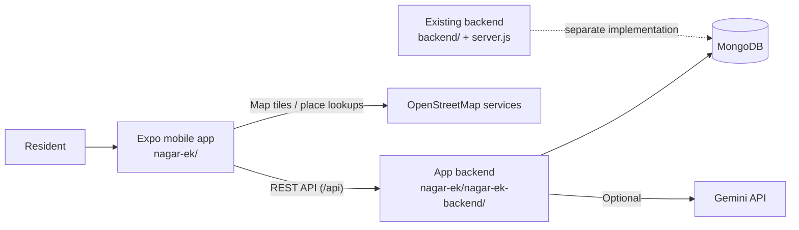

# Nagar-Ek

Nagar-Ek is a civic-services and community-alert system. Residents can report local issues, find government services, view map information, and receive alerts through an Expo mobile app backed by Express APIs and MongoDB.

## What the system includes

- **Mobile app:** Expo, React Native, TypeScript, Expo Router, and Zustand.
- **App backend:** Express, MongoDB/Mongoose, JWT authentication, Socket.IO, and Swagger.
- **Maps and location:** Device location, map-based alert location selection, OpenStreetMap/Leaflet map views, and stored points of interest.
- **Notifications:** In-app notification records, unread counts, foreground alert checks, and best-effort background fetch.
- **Government-service assistant:** Optional Gemini integration using government-service records as its context, with a keyword-based fallback when no API key is configured.

## System architecture



The app's default API should be the backend in `nagar-ek/nagar-ek-backend/`. The `backend/` directory was already present in this repository and is a separate implementation; its routes and behavior can differ. Keep them separate unless you intentionally reconcile their APIs.

## Repository layout

| Path | Purpose |
| --- | --- |
| [`nagar-ek/`](./nagar-ek/) | Expo Router mobile app |
| [`nagar-ek/nagar-ek-backend/`](./nagar-ek/nagar-ek-backend/) | Express API referenced by the mobile app |
| [`backend/`](./backend/) | Existing, separate backend implementation |
| [`server.js`](./server.js) | Entry point used by the existing root backend |

Each app/backend folder has its own `package.json` and dependencies. Install and run them from their respective directories.

## Main app features

- **Account and profile:** Registration, login, JWT-backed sessions, profile data, location updates, and light/dark theme selection.
- **Home:** Recent alerts, feature shortcuts, user points, and refreshes when a new alert is detected.
- **Community alerts:** Create reports with a category, description, location, and optional image; open alert details; browse recent alerts.
- **Notifications:** View alert and notification records, filter the list, mark one or all as read, and see an unread indicator.
- **Map:** View map markers and places, choose an alert location, and open directions.
- **Government services:** Browse and search service information, view required documents and office details, and ask the government-services assistant.
- **Smart travel:** Location-aware travel screen and map navigation.

### Alert and notification flow

1. The app submits an alert to the backend, which stores it in MongoDB and can create notifications for users.
2. The backend exposes a Socket.IO `newAlert` event. The current mobile alert service checks recent alerts over HTTP while the app is in the foreground (every 10 seconds) and refreshes relevant screens.
3. The app compares alert and device locations and can show a nearby-alert notification. It also registers an Expo background-fetch task with a 10-minute minimum interval to check unread alerts.
4. Background delivery depends on platform and build support. Expo Go may use an in-app alert fallback; background fetch timing is controlled by the operating system.

## App backend API

Base URL: `http://localhost:4000`

API prefix: `/api`

Interactive API documentation: [`/api/docs`](http://localhost:4000/api/docs)

| Area | Routes |
| --- | --- |
| Authentication | `POST /api/auth/register`, `POST /api/auth/login`, `POST /api/auth/logout`, `GET /api/auth/me`, `PUT /api/auth/location` |
| Alerts | `GET /api/alerts`, `GET /api/alerts/recent`, `GET /api/alerts/near`, `GET /api/alerts/:id`, `POST /api/alerts`, `PATCH /api/alerts/:id/status` |
| Notifications | `GET /api/notifications`, `PATCH /api/notifications/:id/read`, `POST /api/notifications/read-all`, `DELETE /api/notifications/:id` |
| Government services | `GET /api/government`, `GET /api/government/:id`, `POST /api/government/seed` |
| Transport | `GET /api/transport`, `GET /api/transport/:id`, `POST /api/transport`, `PATCH /api/transport/:id/location` |
| Dashboard | `GET /api/dashboard` |
| Map places | `GET /api/map/places`, `POST /api/map/places` |
| AI assistant | `GET /api/ai/status`, `POST /api/ai/chat` |

Protected routes require a bearer token returned by login or registration. See the [app backend guide](./nagar-ek/nagar-ek-backend/README.md) for request examples and endpoint details.

## Run locally

### 1. Start MongoDB

Use a local MongoDB instance or a MongoDB Atlas connection string. The API needs a database before it can serve application data.

### 2. Configure and start the app backend

From `nagar-ek/nagar-ek-backend/`, create a `.env` file:

```env
PORT=4000
MONGODB_URI=mongodb://127.0.0.1:27017/nagar-ek
JWT_SECRET=replace-with-a-long-random-secret
# Optional: enable Gemini-powered answers
GEMINI_API_KEY=
# Optional; defaults to gemini-2.0-flash-lite
GEMINI_MODEL=gemini-2.0-flash-lite
```

Then install dependencies and start the API:

```bash
cd nagar-ek/nagar-ek-backend
npm install
npm run dev
```

### 3. Configure and start the mobile app

Create `nagar-ek/.env` and set the API base URL, including `/api`:

```env
EXPO_PUBLIC_API_URL=http://localhost:4000/api
```

Then run Expo:

```bash
cd nagar-ek
npm install
npm start
```

Use `npm run android`, `npm run ios`, or `npm run web` for the corresponding Expo target. A physical phone or emulator must use a backend address it can reach; `localhost` on the phone refers to the phone itself, not your development computer.

### Existing backend in `backend/`

This repository also retains its original backend. Its package scripts start the root [`server.js`](./server.js); see [`backend/README.md`](./backend/README.md) for its setup and feature notes. It also uses port `4000` by default, so do not run both backends on that port at the same time. Point the mobile app to this backend only after confirming that its API supports the app's required routes.

## Configuration and data

| Variable | Used by | Purpose |
| --- | --- | --- |
| `EXPO_PUBLIC_API_URL` | Mobile app | Backend base URL, including `/api` |
| `MONGODB_URI` | Backend | MongoDB connection string |
| `JWT_SECRET` | Backend | Signs and verifies authentication tokens |
| `PORT` | Backend | HTTP port; defaults to `4000` |
| `GEMINI_API_KEY` | App backend, optional | Enables Gemini responses for the government-services assistant |
| `GEMINI_MODEL` | App backend, optional | Gemini model; defaults to `gemini-2.0-flash-lite` |

The app backend uses MongoDB collections for users, alerts, government services, transport routes, map places, and notifications. Alert uploads are served from `/uploads`. Never commit `.env` files, API keys, database credentials, or production tokens.

## Current limitations

- Smart Travel displays a sample estimated time; live routing and transport-route integration are not complete.
- Native/background notifications depend on an appropriate Expo development build and operating-system scheduling.
- The app uses a default profile image and does not currently provide profile-photo upload.
- Points are displayed, but a full earn/redeem flow is not implemented.
- Gemini answers require `GEMINI_API_KEY`; without it, the backend uses a limited keyword-based response.

## Development checks

From `nagar-ek/`, run `npm run lint` to lint the mobile app. The existing backend package in `backend/` defines `npm run lint`. The app backend currently provides `dev` and `start` scripts.
